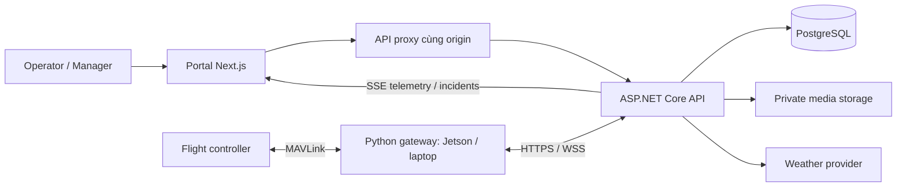

# DroneOps Intelligence

**DroneOps Intelligence là nền tảng web quản lý nhiệm vụ bay drone từ lập kế hoạch, kiểm tra và phê duyệt đến thực thi, giám sát và xem lại kết quả.** Hệ thống kết nối với flight controller qua gateway MAVLink để đưa dữ liệu drone lên portal, đồng thời lưu kế hoạch, quyết định duyệt, telemetry và sự cố phục vụ tra cứu sau chuyến bay.

Người vận hành có thể chuẩn bị tuyến bay theo waypoint, gửi quản lý duyệt, kết nối đúng drone và theo dõi chuyến bay trên một giao diện. Người quản lý có thể xem hồ sơ phi công, duyệt UAV và mission, kiểm tra bằng chứng validation, theo dõi sự cố và đánh giá kết quả vận hành. Phần AI hỗ trợ đối chiếu các chuyến bay lịch sử tương tự và trình bày rủi ro cùng dữ liệu làm căn cứ.

## Dự án dành cho ai?

| Nhóm người dùng | Nhu cầu | DroneOps hỗ trợ |
| --- | --- | --- |
| Người vận hành drone / UAV Operator | Chuẩn bị chuyến bay, biết kế hoạch có vấn đề gì và theo dõi đúng thiết bị | Quản lý hồ sơ, đăng ký UAV, lập tuyến waypoint, xem validation/thời tiết/pin, gửi duyệt, kết nối gateway và giám sát telemetry |
| Người quản lý vận hành / Operations Manager | Kiểm soát người vận hành, thiết bị và các kế hoạch được phép thực hiện trong hệ thống | Duyệt hồ sơ và giấy phép, xem đội UAV, duyệt hoặc từ chối mission, xem thay đổi đề xuất, sự cố và báo cáo |
| Nhóm vận hành nhiều drone hoặc nhiều chuyến bay | Tập trung kế hoạch, giảm nhầm thiết bị và phát hiện lịch bay chồng nhau | Registry UAV, định danh flight controller, danh sách mission, kiểm tra trùng lịch UAV/người vận hành và lịch sử quyết định |
| Nhóm nghiên cứu, đào tạo hoặc phát triển UAV | Thử nghiệm quy trình vận hành, xem dữ liệu và đối chiếu kết quả giữa các chuyến bay | Gateway laptop/Jetson, telemetry trực tiếp, lịch sử chuyến bay, báo cáo, bộ kiểm thử và đánh giá dựa trên dữ liệu lịch sử |

Nền tảng phù hợp khi nhóm cần một quy trình chung giữa người lập kế hoạch và người duyệt, muốn xem dữ liệu drone từ web và giữ lại bằng chứng để đánh giá sau chuyến bay. Người dùng vẫn cần drone/flight controller tương thích và đường truyền từ gateway đến backend để sử dụng các chức năng kết nối thực tế.

## Những tính năng chính

### 1. Tài khoản, hồ sơ và giấy phép người vận hành

- Gửi hồ sơ đăng ký phi công kèm tài liệu giấy phép để quản lý xem xét, duyệt hoặc từ chối.
- Kích hoạt tài khoản qua OTP ở lần đăng nhập đầu; hỗ trợ gửi lại mã theo thời gian chờ.
- Xem và cập nhật tên, số điện thoại, ngày sinh, kinh nghiệm bay và avatar.
- Đổi email bằng mã xác nhận gửi đến địa chỉ mới; đăng nhập lại sau khi đổi thành công.
- Gửi yêu cầu đổi giấy phép và xem trạng thái, lý do từ chối, lịch sử quyết định. Giấy phép hiện hành được giữ trong khi yêu cầu đang chờ hoặc bị từ chối.
- Phân quyền portal và API theo hai vai trò `uav_operator` và `operation_manager`; tài liệu hồ sơ được truy cập qua backend có xác thực.

### 2. Quản lý UAV và nhận diện đúng thiết bị

- Người vận hành đăng ký, xem, sửa và xoá UAV của mình theo quyền và ràng buộc dữ liệu; tải lên ảnh UAV.
- Quản lý xem danh sách đội UAV, tìm kiếm, lọc trạng thái, phân trang, xem chi tiết, duyệt/từ chối và kích hoạt/vô hiệu hoá thiết bị.
- Lưu thông số như model, trọng lượng, thời gian bay, tốc độ và thông số bộ pin để phục vụ lập kế hoạch, hiển thị và đánh giá.
- Kiểm tra ảnh UAV bằng dịch vụ moderation; backend có cơ chế thử lại và ghi nhận trường hợp cần xem xét thủ công.
- Gắn UID của flight controller với hồ sơ UAV để kiểm tra đúng thiết bị khi ghép gateway hoặc kết nối lại.

### 3. Lập kế hoạch mission trên bản đồ

- Tạo tuyến nhiều waypoint theo thứ tự, đặt thời gian bắt đầu/kết thúc, tốc độ, độ cao và hệ quy chiếu độ cao.
- Chọn điểm đầu `TakeOff`, điểm giữa `FlyThrough` hoặc `Hover`, điểm cuối `Land`; khai báo thời gian dừng khi chọn Hover.
- Chọn chế độ mission, cấu hình Home dự kiến và hàng rào giới hạn tuyến dạng polygon hoặc hình tròn.
- Chỉnh sửa kế hoạch và xem rõ nội dung hiện hành so với phần đề xuất thay đổi.
- Kiểm tra xung đột lịch của UAV và người vận hành; thông báo nêu mission đang chiếm lịch cùng thời gian theo múi giờ Việt Nam.
- Tra cứu danh sách, chi tiết, trạng thái, lịch sử yêu cầu và quyết định duyệt của mission.

### 4. Kiểm tra kế hoạch, thời tiết và rủi ro pin

- Kiểm tra tham số, waypoint và các đoạn nối với dữ liệu khu vực bay, vùng hạn chế và giới hạn độ cao.
- Quản lý polygon vùng trời cùng quy tắc độ cao; backend lưu revision và bằng chứng restriction dùng khi kiểm tra.
- Lấy dự báo theo vị trí và thời gian của tuyến bay, hiển thị nguồn, thời điểm, đơn vị và cảnh báo. Các waypoint gần nhau có cùng dự báo được gom để dễ đọc.
- Ước tính nhu cầu pin theo kế hoạch và thông số UAV; phần AI có thể kết hợp telemetry pin mới để trình bày mức pin hiện tại, dung lượng cấu hình và dữ liệu còn thiếu.
- Hiển thị validation theo trạng thái Pass, Fail, Incomplete, Error hoặc Stale, kèm run/request identity và vị trí waypoint/segment liên quan.
- Phân biệt dữ liệu dự báo với dữ liệu cảm biến; giá trị không có dữ liệu được thể hiện là chưa có, không thay bằng số đo giả.

### 5. Phê duyệt mission và kiểm soát thay đổi

- Tạo hoặc lưu kế hoạch qua luồng tự kiểm tra và gửi review theo contract backend hiện tại.
- Quản lý xem hàng đợi duyệt, kế hoạch hiện hành, nội dung đề xuất, bằng chứng validation và lịch sử trước khi quyết định.
- Chặn thao tác approve trên giao diện khi bằng chứng lỗi, thiếu, cũ hoặc không khớp mission/request/run đang xem.
- Ghi nhận người duyệt, thời điểm, kết quả và lý do từ chối; tách trạng thái yêu cầu sửa khỏi trạng thái mission.
- Giữ kế hoạch hiện hành khi đề nghị sửa chưa được chấp thuận; hỗ trợ huỷ mission trước bay theo trạng thái và quyền được phép.

### 6. Kết nối drone qua gateway

- Ghép gateway bằng mã một lần từ portal, kiểm tra UID flight controller và lưu đăng ký gateway tin cậy cho lần kết nối sau.
- Hỗ trợ gateway Python chạy trên **Jetson gắn trên drone** hoặc **laptop nối radio telemetry/USB/UDP forwarding**.
- Tải gói gateway từ portal; có launcher Windows/macOS/Linux và bộ cài service cho Jetson.
- Xem trạng thái phiên, thời điểm gateway/telemetry gần nhất và thu hồi kết nối khi cần.
- Phân biệt gateway có kết nối Internet với việc flight controller đang thực sự gửi dữ liệu.

### 7. Thực thi mission tự động theo waypoint

Luồng hiện tại cho ArduCopter thực hiện **chuẩn bị mission → upload → tải ngược để xác minh → phi công xác nhận → ARM → đếm 10 giây → START**. Drone đi lần lượt qua các waypoint, đến điểm cuối ở độ cao đã đặt rồi hạ cánh; các điểm Hover giữ thời gian được cấu hình.

- Kế hoạch Automatic phải được duyệt, đúng UAV/UID, còn khoảng thời gian hợp lệ và đạt các điều kiện readiness.
- Đọc GPS, Home, phiên bản và tham số từ flight controller; kiểm tra pre-arm và nội dung mission onboard.
- Phi công thao tác ARM từ Live Monitoring; chỉ bắt đầu đếm ngược sau khi nhận xác nhận ARM từ FC. Có thao tác huỷ đếm ngược/DISARM theo điều kiện trạng thái trên mặt đất.
- Tuyến cơ bản giữ failsafe onboard đang cấu hình. Recovery mở rộng là tuỳ chọn riêng, không phải dữ liệu bắt buộc để tạo tuyến cơ bản.
- Backend và gateway đều có công tắc bật thực thi; chỉ kết nối telemetry hoặc duyệt mission chưa tự gửi lệnh bay.

Hướng dẫn sát luồng hiện tại: [Thực thi mission theo waypoint](docs/waypoint-flight-execution.vi.md). Hệ thống có contract/compiler cho ArduPilot Copter và PX4 multicopter; adapter runtime và yêu cầu dữ liệu phụ thuộc firmware. Không dùng kết quả kiểm tra ArduCopter để khẳng định đã nghiệm thu PX4 hoặc mọi loại drone.

### 8. Giám sát trực tiếp, cảnh báo và xử lý sự cố

- Chọn mission/UAV trong phạm vi tài khoản; xem bản đồ tuyến bay và vị trí drone từ telemetry.
- Hiển thị vị trí, độ cao/reference, tốc độ, flight mode, armed state, waypoint/progress và thời điểm dữ liệu khi nguồn cung cấp.
- Theo dõi pin: phần trăm, điện áp, dòng điện, công suất, nhiệt độ, dung lượng đã dùng và điện áp từng cell tuỳ khả năng thiết bị.
- Phân biệt online, stale, offline và last-known position; cập nhật lại snapshot khi kết nối phục hồi.
- Phát hiện các điều kiện như mất liên lạc, pin thấp, vượt độ cao/tốc độ và vi phạm hàng rào; lưu giá trị, ngưỡng và telemetry làm bằng chứng.
- Xem danh sách/chi tiết sự cố, acknowledge, ghi lý do xử lý và resolve theo quyền backend hiện hành; lưu lịch sử chuyển trạng thái.
- Nhận thông báo trong portal, xem số chưa đọc, mở đúng mission/sự cố và đánh dấu đã đọc. Có nhắc kết nối hoặc xác nhận khi đến thời gian chuẩn bị mission.

### 9. Lịch sử, báo cáo và tổng quan vận hành

- Tra cứu flight history theo tên/định danh, thời gian và trạng thái, có phân trang.
- Xem đường bay ghi nhận từ telemetry, thời lượng, dữ liệu pin, sự cố và mức độ đầy đủ của dữ liệu báo cáo.
- Theo dõi trạng thái tạo báo cáo, lý do lỗi và revision; quản lý có thể yêu cầu tạo lại báo cáo kèm lý do.
- Giữ các revision trước và biểu diễn báo cáo Outdated khi có dữ liệu đến muộn cần xử lý lại.
- Dashboard hiển thị tổng quan mission, UAV, sự cố và chỉ số vận hành. Backend analytics cung cấp completion rate, thời lượng, quãng đường ghi nhận, coverage, phân bố mức độ sự cố và xu hướng theo ngày.

### 10. AI hỗ trợ đánh giá dựa trên lịch sử

- Tìm tối đa **5 chuyến bay đã hoàn thành tương tự** trong phạm vi dữ liệu người dùng được phép xem.
- So sánh các đặc trưng ghi nhận như vị trí, thời lượng, độ cao, UAV và sự cố; trả similarity score cùng nguồn bằng chứng.
- Hiển thị tổng hợp rủi ro, lưu ý, dữ liệu còn thiếu và đánh giá pin từ đầu vào backend.
- Lưu kết quả và ngữ cảnh đánh giá để có thể tra cứu lại; không tạo chuyến bay lịch sử giả khi không tìm được dữ liệu phù hợp.

AI đóng vai trò hỗ trợ người dùng đọc bằng chứng và xem xét kế hoạch; quyết định phê duyệt và thao tác vận hành vẫn thuộc người dùng có quyền.

## Một quy trình sử dụng điển hình

1. **Đăng ký và kích hoạt:** Operator gửi hồ sơ/giấy phép, Manager xem xét; Operator hoàn tất kích hoạt tài khoản.
2. **Đăng ký UAV:** bổ sung ảnh và thông số thiết bị, chờ Manager duyệt để sử dụng theo trạng thái cho phép.
3. **Chuẩn bị mission:** chọn UAV, waypoint, lịch, tốc độ/độ cao và chế độ bay; xem kết quả kiểm tra, thời tiết và pin, xử lý lỗi hoặc xác nhận rủi ro khi được yêu cầu.
4. **Gửi và duyệt:** Manager xem kế hoạch/bằng chứng rồi approve hoặc reject. Các lần sửa tiếp theo được trình bày như đề xuất riêng.
5. **Kết nối thiết bị:** Operator ghép đúng gateway và UID, kiểm tra dữ liệu tại Live Monitoring.
6. **Thực hiện và giám sát:** với Automatic, làm theo luồng chuẩn bị/xác nhận/ARM/START; theo dõi vị trí, telemetry, cảnh báo và xử lý sự cố.
7. **Xem lại kết quả:** mở flight history/report, kiểm tra coverage và sự cố; dùng dashboard và đánh giá AI để đối chiếu các chuyến bay.

Ví dụ: một nhóm cần lặp lại tuyến khảo sát có thể lưu UAV và thông số pin, tạo tuyến waypoint cho từng lịch bay, để Manager kiểm tra trước khi thực hiện, theo dõi telemetry trên web và xem lại đường bay/sự cố sau đó.

## Phạm vi triển khai và bằng chứng kiểm chứng

Các mục trên mô tả chức năng có mã nguồn trong repository; từng môi trường cần database, cấu hình dịch vụ, quyền truy cập và thiết bị tương ứng. Giao diện và backend có thể có mức độ hoàn thiện khác nhau, ví dụ backend analytics có nhiều trường hơn các chỉ số đã được đưa lên dashboard.

Unit/contract tests, HTTP fixtures, SITL, kiểm tra trên bàn và bay thực tế là các mức kiểm chứng khác nhau. README không dùng kết quả mô phỏng để công bố đã bay thật. Xem tài liệu chi tiết và kết quả kiểm tra của phiên bản được triển khai khi chuẩn bị vận hành.

## Kiến trúc



Frontend giữ phiên bằng cookie HttpOnly và chuyển yêu cầu qua proxy; backend kiểm tra quyền, xử lý nghiệp vụ và lưu dữ liệu. Gateway trao đổi MAVLink với FC, gửi telemetry và nhận hợp đồng lệnh khi thực thi được bật. Autopilot thực hiện điều khiển bay onboard.

| Thành phần | Công nghệ / trách nhiệm |
| --- | --- |
| Web portal | Next.js 16, React 19, TypeScript, Leaflet; màn hình nghiệp vụ, bản đồ và same-origin proxy |
| Backend | ASP.NET Core .NET 8, JWT, EF Core/Npgsql; API, validation, review, telemetry, workers và báo cáo |
| Dữ liệu | PostgreSQL; schema/migrations và các bản ghi lịch sử, evidence, telemetry |
| Media | Supabase Storage qua backend; avatar, giấy phép và ảnh UAV |
| Gateway | Python, pymavlink, serial/UDP, HTTPS/WebSocket; kết nối FC trên Jetson/laptop |
| Tích hợp | Dự báo thời tiết, SMTP OTP và dịch vụ moderation ảnh theo cấu hình |

### Cấu trúc repository

| Thư mục | Nội dung |
| --- | --- |
| `fe/` | Next.js 16, React 19, TypeScript; portal, bản đồ và API proxy |
| `be/DroneOps/` | .NET 8: API, Application, Domain, Persistence và các chương trình kiểm tra |
| `gateway/` | MAVLink gateway, launcher laptop, installer/service Jetson và đóng gói ZIP |
| `database/` | SQL migrations, thứ tự triển khai và cấu hình dữ liệu |
| `docs/` | Hướng dẫn vận hành và phạm vi chức năng; báo cáo tham khảo trong `reports/` |
| `deploy/`, `scripts/` | Cấu hình service, recovery và công cụ kiểm tra |
| `.github/workflows/` | CI cho backend, frontend, gateway và workflow SITL |

`tmp/`, môi trường Python, dependencies, build output và cấu hình riêng được bỏ qua bằng `.gitignore`.

## Chạy local

Cần Node.js >=20.9 và npm (CI dùng Node.js 24), .NET SDK 8 theo [global.json](global.json), Python cho gateway và PostgreSQL đã áp dụng schema tương ứng. Python 3.11 là lựa chọn phù hợp để tạo môi trường gateway.

### Cấu hình dịch vụ

Backend đọc `appsettings.Local.json` khi chạy Development; biến môi trường có thể ghi đè cấu hình. Đặt file tại `be/DroneOps/DroneOps.API/appsettings.Local.json` và giữ file này ngoài Git.

| Cấu hình | Dùng để làm gì? |
| --- | --- |
| `ConnectionStrings__DefaultConnection` | Kết nối PostgreSQL của môi trường đang chạy; cấu hình TLS/certificate phù hợp database |
| `Jwt__Key`, `Jwt__Issuer`, `Jwt__Audience` | Ký và xác minh JWT cho tài khoản portal |
| `SmtpSettings__Host`, `SmtpSettings__Port`, `SmtpSettings__SenderEmail`, `SmtpSettings__AppPassword` | Gửi OTP và email của các workflow tài khoản |
| `SupabaseStorage__Url`, `SupabaseStorage__ServiceKey` | Endpoint và credential server cho media storage; xem [USER_MEDIA.md](database/USER_MEDIA.md) |
| `UavImageModeration__ApiKey`, `UavImageModeration__Model` | Dịch vụ kiểm tra ảnh UAV |
| `MissionWeather` | Nhóm cấu hình provider/cache/thời tiết của backend |
| `Monitoring__Enabled` | Bật/tắt các worker monitoring theo cách triển khai |
| `FlightExecution__Enabled` | Cho phép backend xử lý thực thi bay; chỉ bật theo hướng dẫn vận hành |

Trong JSON, dùng cấu trúc lồng nhau tương ứng, ví dụ `Jwt:Key`; trong biến môi trường dùng `Jwt__Key`. Không commit mật khẩu, JWT signing key, credential gateway hoặc storage service key. Storage service key chỉ đặt trên backend, không đưa vào `NEXT_PUBLIC_*`; xem [hướng dẫn quyền truy cập Storage](https://supabase.com/docs/guides/storage/security/access-control).

### Khởi chạy API và portal

1. Cấu hình backend bằng biến môi trường hoặc file không commit `be/DroneOps/DroneOps.API/appsettings.Local.json` khi chạy Development. Đặt `ConnectionStrings__DefaultConnection` cho database của môi trường của bạn; cấu hình JWT, SMTP, dịch vụ AI và storage theo tính năng cần chạy. Dùng đường dẫn certificate hợp lệ nếu kết nối database yêu cầu. Không đưa credential vào tài liệu hoặc commit.
2. Chuẩn bị database, role/account quản trị ban đầu và storage cho môi trường của bạn. Áp dụng migration theo [migration-order.txt](database/migration-order.txt), backup trước khi triển khai; không chỉ sắp xếp tên SQL theo alphabet vì có migration cùng tiền tố số. Không coi khởi động API là đã áp đủ mọi migration.
3. Chạy API từ thư mục gốc:

   ```powershell
   dotnet run --project be/DroneOps/DroneOps.API --no-launch-profile -- --urls http://localhost:5159 --environment Development
   ```

4. Trong `fe/`, sao chép [.env.example](fe/.env.example) thành `.env.local`, đặt `API_BASE_URL=http://localhost:5159`. Các biến Firebase web trong mẫu dành cho phần tích hợp Firebase khi sử dụng; luồng đăng nhập portal hiện trao đổi với backend JWT. Không dùng credential Firebase thay cấu hình JWT/SMTP của backend.

   ```powershell
   cd fe
   npm ci
   npm run dev
   ```

| Địa chỉ local | Mục đích |
| --- | --- |
| `http://localhost:3000` | Portal |
| `http://localhost:5159/health` | Kiểm tra API process đang phục vụ HTTP; không thay thế kiểm tra tất cả dịch vụ phụ thuộc |
| `http://localhost:5159/swagger` | API documentation khi chạy Development |

Frontend gọi API qua proxy cùng origin; `API_BASE_URL` là origin backend, không thêm `/api` ở cuối. API có kiểm tra schema lúc startup nên cần hoàn tất chuẩn bị database trước khi kiểm tra các URL trên.

### Kết nối gateway

Vào **Connect Drone** hoặc phần chuẩn bị trong **Live Monitoring**, chọn UAV/mission phù hợp rồi làm theo [hướng dẫn kết nối](docs/drone-connection-guide.md). Tài liệu/gói tải từ môi trường hosted có thể dùng domain cố định; chọn đúng backend khi thử local.

Để phát triển gateway, tạo virtual environment, cài [requirements.txt](gateway/requirements.txt), rồi dùng launcher hoặc bộ cài Jetson theo [gateway/README.md](gateway/README.md). Không để GCS và gateway cùng chiếm trực tiếp một serial port; dùng router/forwarding khi cần chia luồng MAVLink.

## Kiểm tra khi phát triển

Chạy các lệnh phù hợp với phần thay đổi, từ thư mục gốc trừ nhóm frontend:

```powershell
dotnet build be/DroneOps/DroneOps.sln
dotnet run --project be/DroneOps/DroneOps.AuthChecks
dotnet run --project be/DroneOps/DroneOps.TelemetryChecks
dotnet run --project be/DroneOps/DroneOps.PostFlightChecks
```

Gateway, trong môi trường Python đã kích hoạt:

```sh
python -m pip install -r gateway/requirements.txt
python -m unittest discover -s gateway -p 'test_*.py'
python gateway/package.py
```

Trong `fe/`:

```powershell
npm test
npm run typecheck
npm run lint
npm run build
```

Các bộ kiểm tra mặc định bao phủ auth contracts, telemetry/incident HTTP fixtures, post-flight và FE contracts/rendering. Một số chương trình mở HTTP server local và cần quyền bind port. Các chế độ integration có ghi database/storage phải dùng môi trường development; xem [AuthChecks](be/DroneOps/DroneOps.AuthChecks/README.md) trước khi chạy.

[CI](.github/workflows/ci.yml) kiểm tra backend Release/analyzers, frontend lint/typecheck/tests/build và Python gateway. [Workflow SITL](.github/workflows/arducopter-sitl.yml) có phạm vi riêng; kết quả test phần mềm không tự xác nhận deployment hoặc phần cứng.

Đọc [fe/AGENTS.md](fe/AGENTS.md) và hướng dẫn Next.js cài trong dự án trước khi sửa frontend. Giao diện dùng nền navy, accent cyan và token dùng chung trong `tokens.css`; giữ trạng thái focus và hỗ trợ reduced motion.

## Triển khai và bảo trì

- [Dockerfile](Dockerfile) đóng gói backend .NET, lắng nghe port 8080; cấu hình production được cấp từ môi trường triển khai.
- Docker image mặc định đặt `Monitoring__Enabled=false`. Tất cả hosted monitor, kể cả kiểm duyệt ảnh UAV, tuân theo cờ này. [vercel.json](vercel.json) có daemon dùng `--monitor-only` để chạy các worker; giữ monitoring tắt ở API replicas và chỉ bật ở tiến trình monitor. Nếu không có monitor riêng, phải bật `Monitoring__Enabled=true` ở tiến trình được chọn để các tác vụ nền tiếp tục được xử lý.
- Connect Drone chỉ polling khi tab hiển thị và online: session mỗi 5 giây, hardware binding mỗi 30 giây và ngay khi quay lại tab/online; không chồng các lượt polling đang chờ mạng. Các thao tác connect/disconnect/forget vẫn cập nhật dữ liệu ngay sau khi thành công.
- Polling thực thi bay mỗi giây còn giữ nguyên vì gia hạn pilot presence và phản ánh trạng thái ARM/countdown. Root layout vẫn render động để CSP nonce khớp từng request; không bỏ `headers()` riêng lẻ để tối ưu trang công khai. Để đánh giá CPU thực tế, đối chiếu Active CPU theo function/project trước và sau deploy ở cùng thời lượng/tải; số request giảm không tương đương cùng tỷ lệ CPU giảm.
- Frontend cần cấu hình `API_BASE_URL` đúng origin backend. Reverse proxy phải hỗ trợ WebSocket gateway và giữ SSE streaming cho portal.
- Đổi schema theo [migration order](database/migration-order.txt), đồng bộ credential, storage và gateway package với phiên bản release.
- `scripts/recovery/backup.py` và `restore.py` hỗ trợ sao lưu/khôi phục PostgreSQL cùng private media; `deploy/systemd/` có service/timer mẫu. Xem `--help` và cấu hình môi trường đích trước khi dùng.
- `scripts/recovery/package_deployment.py` tạo gói triển khai; `scripts/telemetry-performance.mjs` hỗ trợ đo telemetry. Các script này là công cụ vận hành/đánh giá, không phải bằng chứng rằng backup, restore hoặc load test đã chạy thành công.

## Xử lý lỗi thường gặp

| Hiện tượng | Kiểm tra |
| --- | --- |
| API không khởi động | Connection string, kết nối/TLS PostgreSQL, cấu hình JWT và schema/migration mà startup yêu cầu |
| Portal báo backend unavailable | API đang chạy, `API_BASE_URL`, domain/port và kết nối từ server frontend tới backend |
| Không nhận được OTP | SMTP credentials, sender, quyền gửi mail, thời gian chờ resend và thư mục spam |
| Không upload/xem được hồ sơ | Storage URL/key phía backend, bucket/migration đúng môi trường và thời hạn link tài liệu |
| Gateway online nhưng chưa có vị trí | MAVLink/serial/baud, UID, mission mapping và dữ liệu GPS thực; heartbeat gateway không phải sample GPS |
| Telemetry stale/offline | Packet timestamps, link drone–gateway, Internet tới backend và kết nối SSE của trình duyệt |
| Không xác nhận/ARM được Automatic | Mở Flight readiness/FC settings, kiểm tra plan đã duyệt, pending update, lịch, UID, GPS/Home, pre-arm và upload/read-back theo hướng dẫn waypoint |

## Tài liệu

- [Kết nối Jetson hoặc radio + laptop](docs/drone-connection-guide.md)
- [Vận hành nhiệm vụ bay tự động](docs/automatic-flight-operations.md)
- [Thực thi waypoint — luồng hiện tại](docs/waypoint-flight-execution.vi.md)
- [Luồng người dùng bay tự động](docs/automatic-flight-user-flow.vi.md)
- [Giới hạn vận hành và tham số FC](docs/automatic-flight-operating-envelope.md)
- [Telemetry pin và đánh giá nhu cầu pin](docs/battery-telemetry-and-assessment.md)
- [Diagram cần cập nhật cho phạm vi mới](docs/diagram-update-checklist.md)
- [Gateway và đóng gói](gateway/README.md)
- [Media và hồ sơ phi công](database/USER_MEDIA.md)
- [Nguồn dữ liệu vùng trời](fe/public/data/README.md)
- [Báo cáo dự án](docs/reports/) và [slide](docs/slides/)

Khi làm việc với agent, bắt đầu từ README này và chỉ đọc tài liệu liên quan đến nhiệm vụ. Báo cáo/slide là tài liệu tham khảo theo thời điểm; đối chiếu code cho hành vi hiện tại. Cập nhật hướng dẫn đang có khi chức năng thay đổi, tránh tạo thêm nhật ký hoàn thành hoặc bản tóm tắt trùng nội dung.
